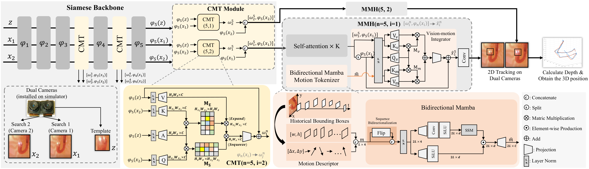
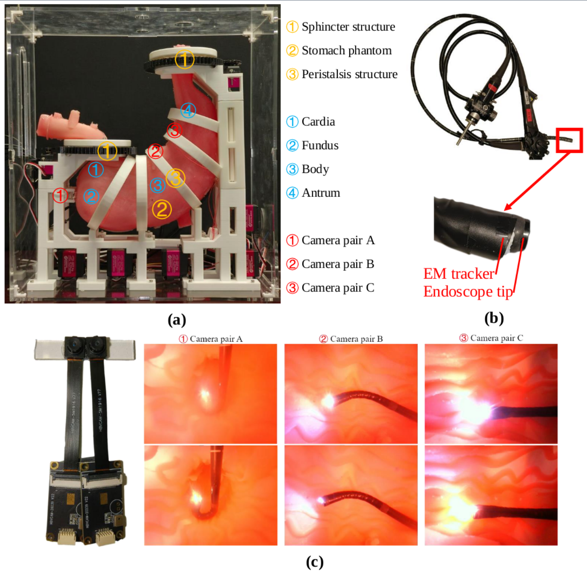
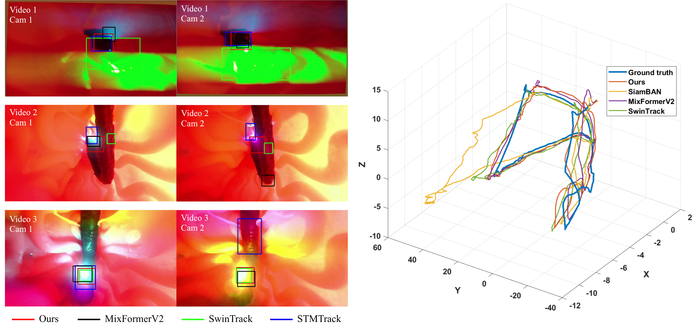

# <p align=center> Motion-Guided Dual-Camera Tracker <br> (MotionDCTrack) </p>

<b><p align=center> A highly robust tracker for tracking on stereo cameras </p></b>

<b><p align=center> <a href='https://arxiv.org/abs/2403.05146'></a>
  ICRA 2025</p></b>


> **_Motion-Guided Dual-Camera Tracker for Endoscope Tracking and Motion Analysis in a Mechanical Gastric Simulator_** <br> Yuelin Zhang, Kim Yan, Chun Ping Lam, Chengyu Fang, Wenxuan Xie, Yufu Qiu, Raymond Shing-Yan Tang, and Shing Shin Cheng<br>
> IEEE International Conference on Robotics and Automation (ICRA) 2025 <br>


## Key Features
- **Dual-Camera-Based Tracking**: Uses a **cross-camera mutual template strategy (CMT)** to enhance tracking consistency and adapt to appearance variations.
- **Motion-Guided Prediction Head (MMH)**: Integrates **historical motion data** using a **Mamba-based motion modeling framework**, improving tracking under occlusion and light-induced distortions.
- **Superior Accuracy**: Outperforms state-of-the-art trackers with **42% lower average error** and **72% lower maximum error** in 3D tracking.
- **Endoscopy Motion Analysis**: Provides reliable motion metrics to differentiate between **expert and novice endoscopists**.


<summary> Structure overview of the proposed MotionDCTrack </summary>
<div style="text-align: center;">
    
</div>


## 🔥 News
- **2025-04-08:** We release the code, weight, and dataset.
- **2025-03-11:** We release this repository.
- **2025-01-28:** Our paper is accepted by ICRA 2025.


## 🩻 Datasets

<summary> Experiment setup.
(a) Self-developed mechanical gastric simulator and installation of dual-camera tracking devices. 
(b) Flexible gastric endoscope with EMT affixed at its tip to provide the 3D ground truth. 
(c) Dual camera pairs used in this work and image examples collected by different camera pairs.
</summary>
<div style="text-align: center;">
    
</div>

We collected and annotated a dataset using a **mechanical gastric simulator**. 
For detail about the gastric simulator, please refer to our paper: _A Highly Distensible, Cable Loop-Driven Soft Robotic Gastric Simulator for Endoscopy Training_ at [JMRR](https://www.worldscientific.com/doi/abs/10.1142/S2424905X23500058).


The **raw dataset** can be downloaded from [Google Drive](https://drive.google.com/file/d/1n1X8Ob8idn2bootcsNsDmgSvtoE0vWZZ/view?usp=sharing).

To apply the dataset for training, one can directly use our **preprocessed dataset**, which can be downloaded from [Google Drive](https://drive.google.com/file/d/1YLIwnn1RVp7U5ThbVstyfoTL5C6KizU5/view?usp=sharing), 
together with the **annotation json** at [Google Drive](https://drive.google.com/file/d/14xuFwGkfY2RMPVR99MCNuHP8G5umhI5x/view?usp=sharing).

The **preprocessed dataset** and **annotation json** should be placed under the `training_dataset/my_endos` folder.


## ⚙️ Dependencies

### Initialize Conda Environment and Clone Repo
```bash
git clone https://github.com/PieceZhang/MotionDCTrack
conda create -n motiondctrack python=3.11
conda activate motiondctrack
# If necessary, Replace pytorch-cuda=? with the compatible version of your GPU driver.
conda install pytorch==2.0.0 torchvision==0.15.1 torchaudio==2.0.1 pytorch-cuda=11.8 -c pytorch -c nvidia
```


### Install
```bash
pip install -r requirements.txt
python setup.py build_ext --inplace  # Build extensions
```

## 🏃 Train

### Download pretrained backbones
Download pretrained resnet50.model from [here](https://drive.google.com/file/d/1Ucg-HeO96FIiNeKlGToNxGHqiNGW4qPG/view?usp=sharing) and put them in `pretrained_models` directory

### Train
```bash
cd ./experiments/motiondctrack
export PYTHONPATH=$PYTHONPATH:/path/to/siamban
python -m torch.distributed.launch \
    --nproc_per_node=4 \
    --master_port=2333 \
    ../../tools/train.py --cfg config.yaml
# This is a command to train the model with 4 GPUs. Modify the code according to your GPU settings.
```


## 🏃‍♂️ Test
The model weight can be downloaded at [here](https://drive.google.com/file/d/1664wA3gbozGPCnVkRJNhhbP8BEFXHdgT/view?usp=sharing).
Put the weight in `experiments/motiondctrack` directory.

### Tracking Demo
You can download an example video in test set from [here](https://drive.google.com/file/d/18U_Ov4v6_FuSbapvdb1QrWqQyBJSH1-r/view?usp=sharing) and put them in `demo_video` directory.
```bash
python tools/test.py
```
For tracking using 6 cameras, using test_multicams.py instead.
```bash
python tools/test_multicams.py
```

### Evalutation

```bash
cd /experiment/motiondctrack
python ../../tools/eval.py --dir /path/to/your/rawdataset
```

## 🔍 Results

<summary> Left: Demonstration of the dual-camera tracking comparison. Our tracker not only achieves the most accurate tracking under multiple disturbances but also has the best tracking consistency across the dual cameras.
Right: 3D motion trajectory ground truth measured by EMT and estimated 3D motion from different methods.  </summary>
<div style="text-align: center;">
    
</div>


## 📎 Citation
If you find our work helpful, please consider citing our paper:

MotionDCTrack: (official link will be updated soon)
```
@article{zhang2024motion,
  title={Motion-Guided Dual-Camera Tracker for Endoscope Tracking and Motion Analysis in a Mechanical Gastric Simulator},
  author={Zhang, Yuelin and Yan, Kim and Lam, Chun Ping and Fang, Chengyu and Xie, Wenxuan and Qiu, Yufu and Tang, Raymond Shing-Yan and Cheng, Shing Shin},
  journal={arXiv preprint arXiv:2403.05146},
  year={2024}
}
```


Gastric Simulator:
```
@article{lam2024highly,
  title={A Highly Distensible, Cable Loop-Driven Soft Robotic Gastric Simulator for Endoscopy Training},
  author={Lam, Chun Ping and Zhang, Yuelin and Yan, Kim and Ding, Qingpeng and Tang, Raymond Shing-Yan and Cheng, Shing Shin},
  journal={Journal of Medical Robotics Research},
  pages={2350005},
  year={2024},
  publisher={World Scientific}
}
```
